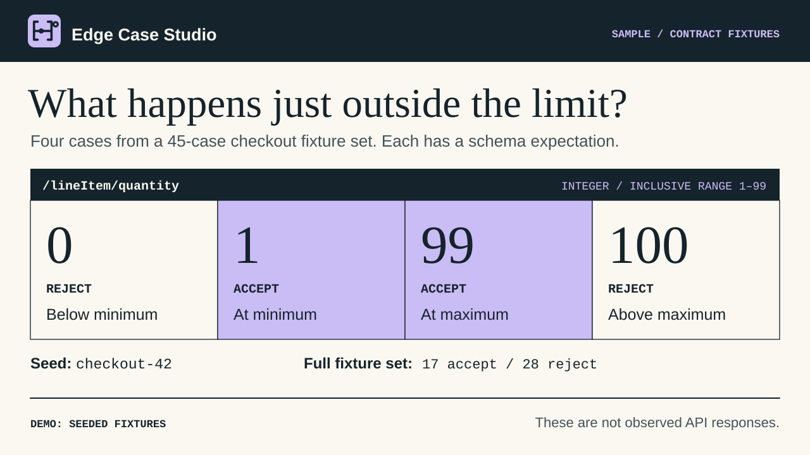

# Edge Case Studio

**Give it a JSON contract. Get the payload that should pass and the one that should fail.**

A checkout accepts quantities from 1 through 99. What does a request with a quantity of 100 look like when *everything else is still valid*? Edge Case Studio generates that exact request, the matching 99, and the field and rule that explain the difference. Use the pair to write a regression test without copying a customer record.

**Try it:** open [the checkout workbench](examples/checkout-report.html) from the extracted folder in your browser. No runtime needed. Search for **quantity** and select the rows for 0, 1, 99 and 100. **Save JSONL** always exports the full suite, even when a filter is active.

| Payload change | Expected by the checkout schema |
| --- | --- |
| Quantity 0 → 1 | Reject for minimum → accept |
| Quantity 99 → 100 | Accept → reject for maximum |
| Omit optional couponCode | Accept |
| Omit required lineItem.sku | Reject for required |
| Set giftWrap to false | Accept: false is not a missing value |

The sample produces **45 cases: 17 should pass, 28 should fail**. These are schema expectations, not observations about an API. The tool does not test a server, place orders, check SKU availability or predict HTTP status codes.



*Illustration from the bundled synthetic fixture. [Cover artwork](assets/cover.png) and [alt text](assets/ALT-TEXT.md).*

## Try it in Cursor

In a Cursor workspace where this plugin is available, look under **Tools & MCP** for the `checkout_quantity_pair` tool. It needs an existing Node.js 18+ runtime on PATH and uses only the bundled synthetic checkout. Try:

> Call checkout_quantity_pair with seed checkout-42 and boundary maximum. Show the two full fixture payloads and the exact failed rule.

You should see quantity **99 accepted** and **100 rejected** for `maximum` at `/lineItem/quantity`, with all other values identical. Change `boundary` to `minimum` for 1 (accept) and 0 (reject). The tool returns two rows, plus counts for the full suite: 45 total, 17 accept, 28 reject. Cursor may prefix the tool's name. Confirm the tool actually ran; an answer without a tool call is not verification.

This is a **fixture-only demo**. The native tool accepts only an optional boundary and seed, not a schema, path, URL or request body. To generate a full matrix from your own supported synthetic schema or export JSON, JSONL or HTML, use the local CLI below. Inside Cursor, the included `/edge-case-matrix` command and `edge-case-studio` skill document that separate CLI workflow. They require a host that permits using the local generator; availability of the MCP demo does not imply the host can execute the CLI.

For a local test, [use Cursor's documented local plugin directory](https://cursor.com/docs/plugins), or register the tool in a disposable workspace: place this repository as `edge-case-studio` inside that workspace and create `.cursor/mcp.json` there:

```json
{"mcpServers":{"edge-checkout":{"command":"node","args":["${workspaceFolder}/edge-case-studio/scripts/checkout-mcp.cjs"]}}}
```

The workspace registration tests the tool, not plugin discovery. No setting changes or automatic approvals are required; leave any managed policy in place. The server reads standard input and prints its result over MCP. It makes no network calls, executes no shell commands and takes no caller-supplied files. Your host may send the synthetic fixture output to its configured model.

## Run the full generator locally

From the extracted **edge-case-studio** folder, use an existing Node.js 18+ runtime. No installation step, configuration, API key or network access is needed.

~~~sh
node scripts/edge-case.cjs --seed checkout-42 --format jsonl
node scripts/edge-case.cjs --help
~~~

Your own file must be a **schema**, not a request body or an OpenAPI document. Pass it on standard input. In POSIX shells or Windows Command Prompt:

~~~sh
node scripts/edge-case.cjs --stdin --seed demo-7 --format jsonl < examples/checkout.schema.json
~~~

From PowerShell, let Command Prompt handle file redirection so UTF-8 bytes are preserved across PowerShell versions:

~~~powershell
cmd /d /c "node scripts/edge-case.cjs --stdin --seed demo-7 --format jsonl < examples/checkout.schema.json"
~~~

Choose **json** (default) for the whole suite and counts; **jsonl** for a test runner; **html** for an interactive report. By default, the CLI only writes standard output. For a file, redirect to a **new** filename: shell redirection may otherwise overwrite it. On PowerShell, use the cmd wrapper above for byte-exact file export as well.

## Use one case in a test

Every line in [the sample JSONL](examples/checkout.cases.jsonl) has an expected outcome, a stable case ID, its full payload, and the exact error location as a JSON Pointer. For this sample, **past-maximum:/lineItem/quantity** expects:

~~~json
{"pointer":"/lineItem/quantity","rule":"maximum"}
~~~

Feed the payload into **your own validator** and compare its outcome with the expectation. For validators that report a missing or extra property at the parent object, append the affected property to get our pointer convention. Each rejection changes exactly one value or presence decision relative to the seed baseline. Passing boundary cases may equal the baseline. A seed is for replay, not secrecy or uniqueness.

## Supported contract

| Part | Supported |
| --- | --- |
| Root and nesting | Single explicit object at root; explicit type at every node: object, integer, string or boolean. At most 32 declared fields total, paths up to three segments. Objects require properties. |
| Object rules | required must list unique declared fields; additionalProperties may be true or false. Undeclared-field negatives are generated only for explicitly closed objects. |
| Integers | Inclusive minimum and maximum within ±1,000,000. Numerically exact integer notations such as 1.0 and 1e2 work; noninteger or rounded-away fractions are refused. |
| Strings | minLength / maxLength from 0 to 64 Unicode code points, **or** 1–12 unique string enum values, each at most 64 code points; no unpaired surrogates. |
| Names and replay | Printable non-space ASCII field names, 1–40 characters. Reserved: __proto__, prototype, constructor. Seeds: 1–64 ASCII letters, digits, underscores, hyphens or periods; use --seed=TOKEN when a token begins with two hyphens. |
| Input | UTF-8 JSON up to 32 KiB. An optional root dialect must be https://json-schema.org/draft/2020-12/schema. Duplicate keys are refused. |

No arrays, mixed types, general numbers, references, regex/format, defaults, conditional schemas or business rules. Unsupported inputs exit **2**, explain the refusal on stderr and emit no fixtures. A string enum has no type-only negative because null breaks both type and enum. A minimum string length of zero has no below-zero case.

The same generator version, seed and contract replay the same JSONL bytes. Reordering schema properties or required names does not change the output; enum order does. Schema field names, seed and enum strings are preserved in exports. Use synthetic values. The local program makes no requests and has no telemetry; passing data to an AI chat is a separate action governed by the host.

## Verify

~~~sh
node scripts/check-package.cjs
node --test tests/core.test.cjs tests/report.test.cjs tests/cli.test.cjs tests/checkout-mcp.test.cjs
~~~

See [QA.md](QA.md) for reproducible checks. Package 0.1.2 adds the native demo; the fixture generator is still 0.1.1 so existing JSONL replay stays byte-identical.


## License

[MIT](LICENSE).
